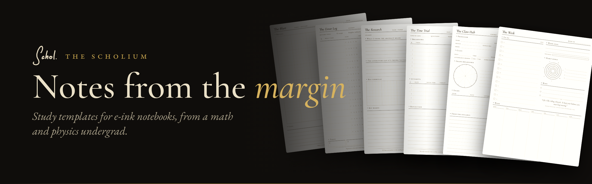
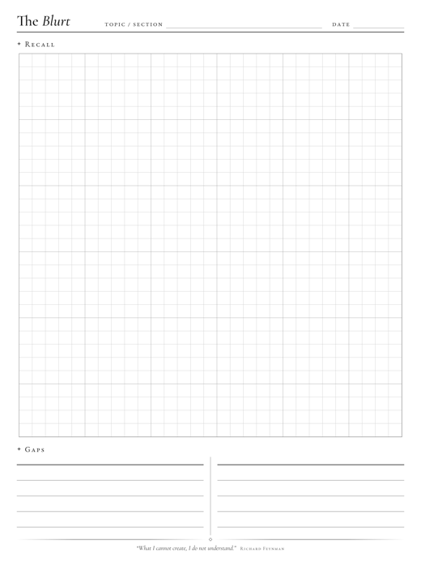
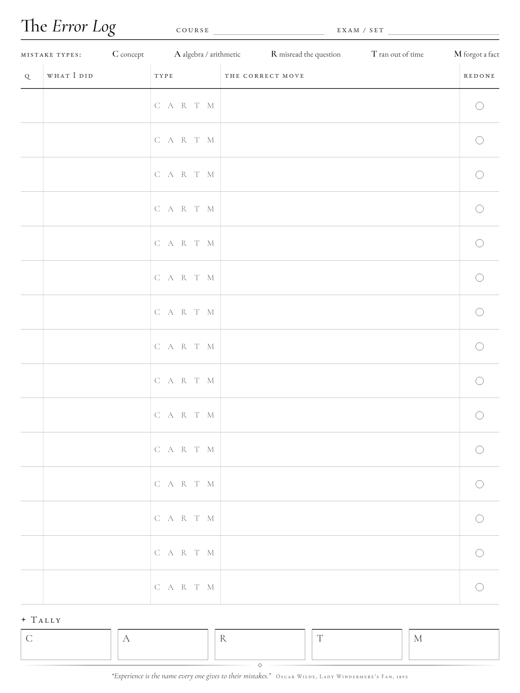
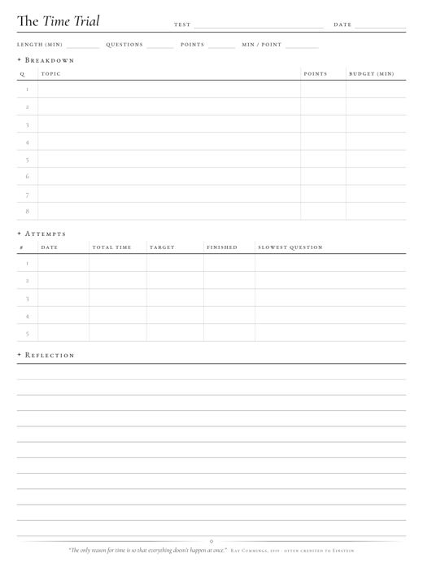
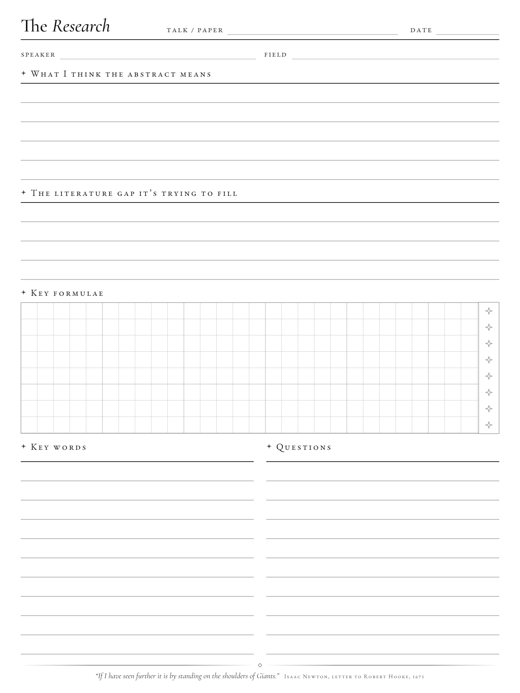
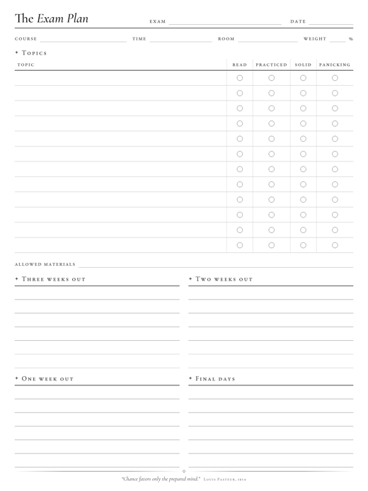
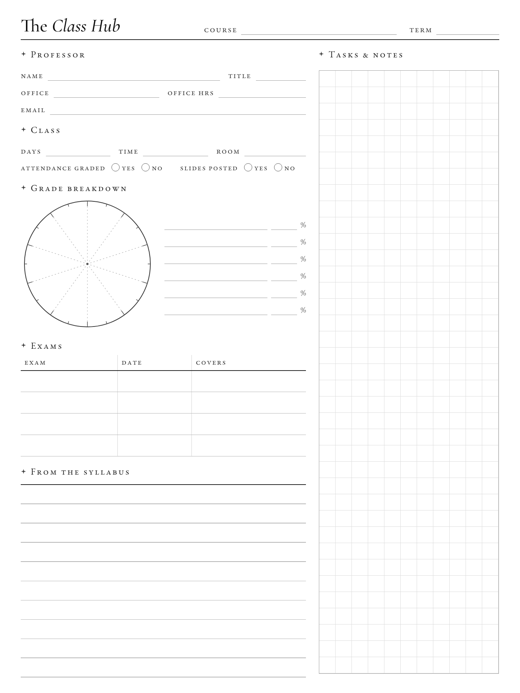
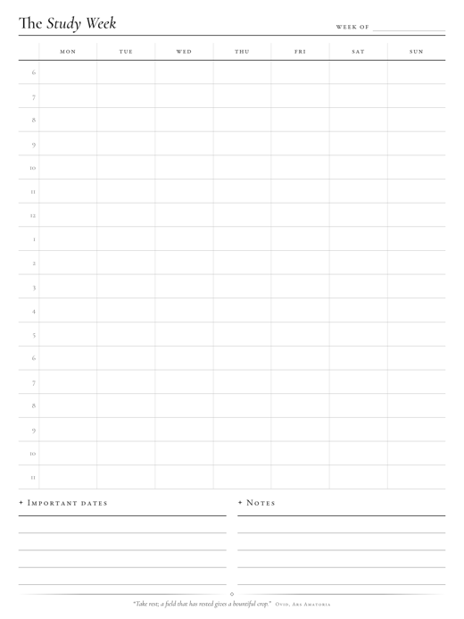
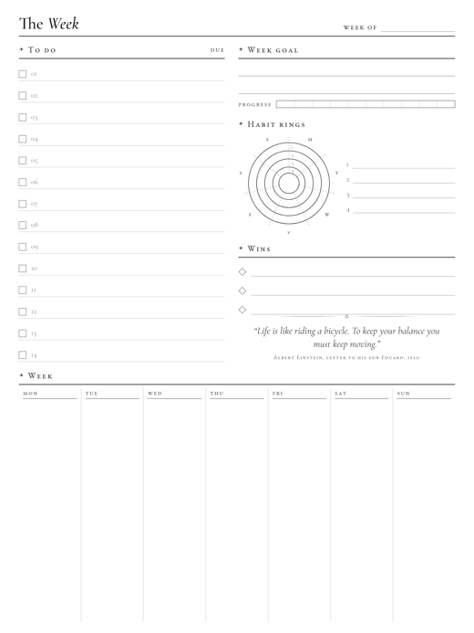
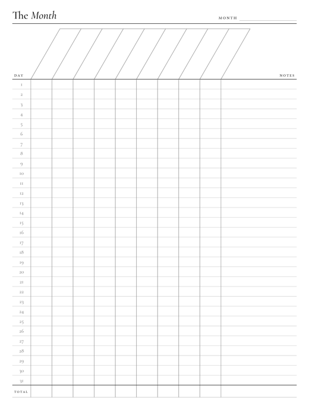

Most planner templates are made for planning brunch. These are for the other thing: closing the textbook and finding out what you actually remember, logging the same sign error until you stop making it, and sitting through a colloquium that is three courses over your head.

I'm a math and physics undergrad, and these are the pages I use on my Supernote Nomad. They're free, undated, and meant to be written on hundreds of times.

**[Browse them on the website →](https://thescholium.github.io/scholium)**

## The pages

<table>
<tr>
<td align="center" width="33%"> <b>The Blurt</b> Close the book. Write everything you remember on graph paper. The blank spots are your study list.</td>
<td align="center" width="33%"> <b>The Error Log</b> Every mistake, what kind it was, and the move you should have made. Mistakes are data.</td>
<td align="center" width="33%"> <b>The Time Trial</b> A time budget for each question, then five timed attempts. For exams where the clock is the hard part.</td>
</tr>
<tr>
<td align="center"> <b>The Research</b> For a paper or a talk way over your head: what you think the abstract means, the formulas that matter, the words to look up later.</td>
<td align="center"> <b>The Exam Plan</b> Every topic, rated: read, practiced, solid, or panicking. Then a three-week countdown.</td>
<td align="center"> <b>The Class Hub</b> One page per course: professor, office hours, grading, exam dates, the policies you will forget.</td>
</tr>
<tr>
<td align="center"> <b>The Study Week</b> 6 a.m. to midnight, seven days, no dates. Block it out, then see where the week really went.</td>
<td align="center"> <b>The Week</b> A to-do list, one goal, habit rings, and a box for wins, because those get forgotten first.</td>
<td align="center"> <b>The Month</b> Nine habits down the days of the month. Comes in 28, 30 and 31-day versions.</td>
</tr>
</table>

## Putting them on your tablet

**Supernote Nomad:** download the [latest release](https://github.com/TheScholium/scholium/releases/latest) and unzip it. Plug the Nomad in over USB (or use the Supernote Partner app), copy the PNG files into the **MyStyle** folder, and they'll show up as custom templates when you make a new note.

**reMarkable 2:** same resolution (1404 × 1872), so the files fit as they are. Copy them over the way you add any custom template.

Versions with room for the Nomad's toolbar are on the way.

## Why "scholium"

A *scholium* is the note that comes after a proof: the remark in the margin that explains what just happened, or argues with it. Newton's *Principia* and Spinoza's *Ethics* are full of them. Medieval readers wrote them in the margins of everything they read, and later copyists kept them with the text. That is roughly the idea here: tools for the notes you write around the material, not just about it.

## Also from The Scholium

**[Istari](https://github.com/TheScholium/istari)**, a dark, bookish theme for Obsidian with proper theorem callouts, and **[Istari Companion](https://github.com/TheScholium/istari-companion)**, a plugin that moves footnotes into the margin.

## The fine print

- **Templates:** [CC BY-NC-SA 4.0](LICENSES/CC-BY-NC-SA-4.0.txt). Use them, share them, change them. Credit The Scholium, don't sell them, and share your versions under the same terms.
- **The build script** in [`templates/src`](templates/src): [MIT](LICENSES/MIT.txt). It draws every page from HTML and CSS, so you can change the sizes or make your own.
- **Fonts:** EB Garamond and Cormorant Garamond, under the [SIL Open Font License](LICENSES/OFL-1.1.txt).

Found a mistake, or want a page that doesn't exist yet? [Open an issue](https://github.com/TheScholium/scholium/issues) or write to scholium.notes@gmail.com.

Instagram [@the.scholium](https://instagram.com/the.scholium) · Reddit [u/the_scholium](https://reddit.com/u/the_scholium) · Pinterest [@thescholium](https://pinterest.com/thescholium)
