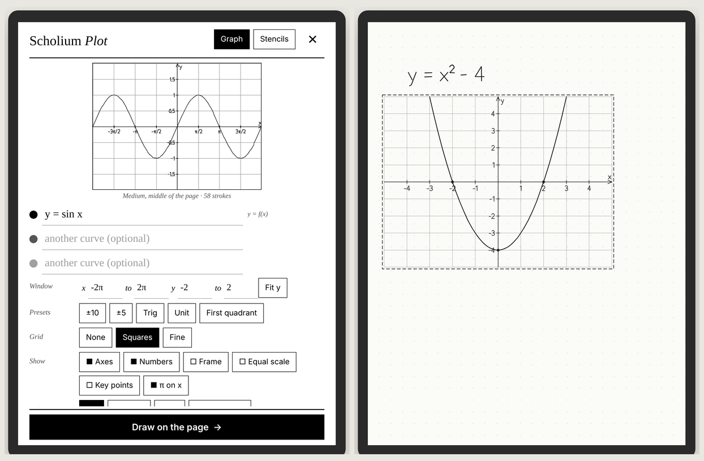
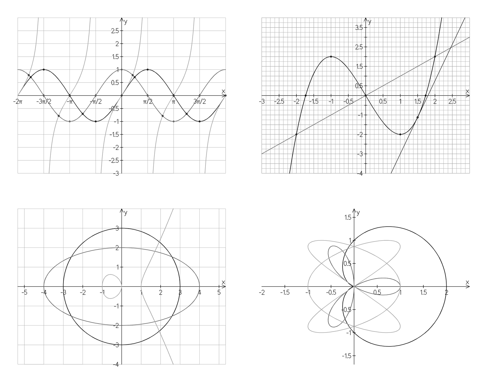
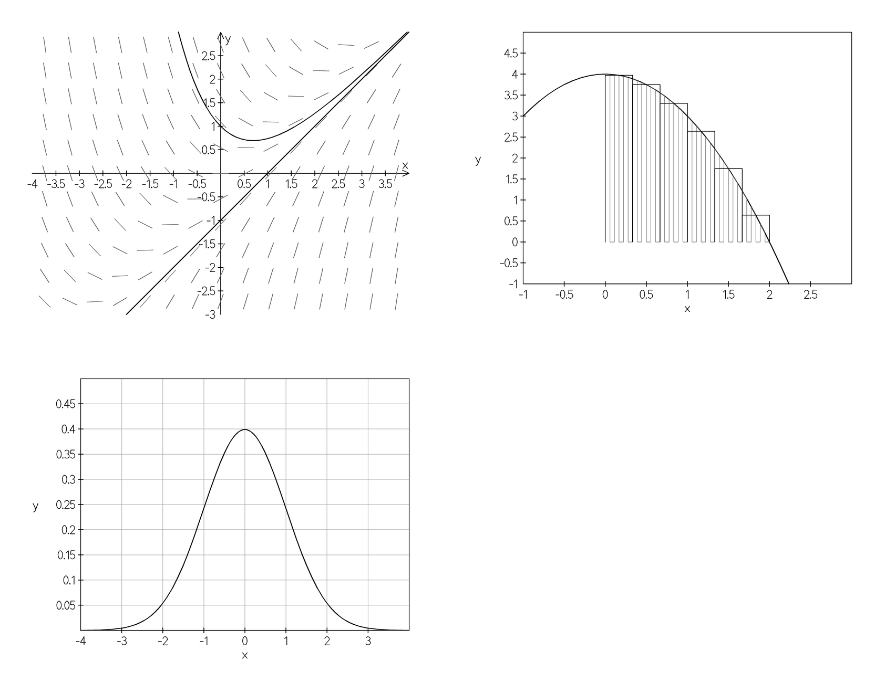
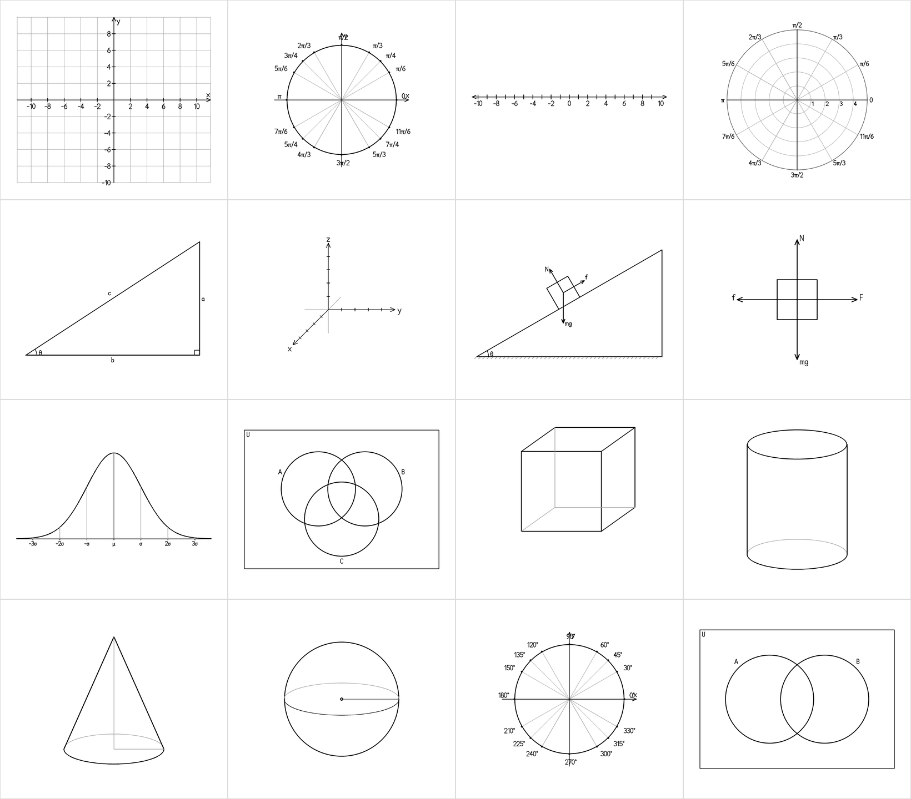

<p align="center"></p>

# Scholium Plot

A Supernote plugin that draws graphs onto your page. Not a picture of a graph: real pen strokes, the same kind your own pen makes, so you can erase a bit, write on top, lasso it and move it.

Type `y = x^2 - 4` and tap **Draw**. Or write the equation by hand, lasso it, tap **Plot**, and the graph lands right under what you wrote.

**[Try it in your browser →](https://thescholium.github.io/scholium/plot/)** (a pretend Nomad running the real plugin code)

> **Early days.** This is version 0.1. Every part of it has been tested on a laptop, and the plugin package builds with Ratta's own tools, but it has not been run on a real Supernote yet. Line widths in particular are a guess. If something looks wrong on yours, [open an issue](https://github.com/TheScholium/scholium/issues) with a photo and I'll fix it.

## What it draws

<p align="center"></p>

Up to three curves at once, in black, dark gray and light gray. It works out what kind of curve you typed:

| You type | You get |
| --- | --- |
| `y = sin x`, `x^3 - 3x`, `f(x) = e^(-x^2)` | an ordinary graph |
| `x = y^2` | a sideways one |
| `x^2 + y^2 = 9`, `y^2 = x^3 - x` | an implicit curve, any equation in x and y |
| `r = 1 + cos θ` | a polar curve |
| `(cos 3t, sin 2t)` or `x = cos t, y = sin t` | a parametric curve |
| `y' = x - y` | a slope field |
| `y' = x - y, y(0) = 1` | a slope field and the solution through (0, 1) |

It reads math the way people write it: `2x`, `sin x cos x`, `sin^2 x`, `(x+1)(x-1)`, `|x|`, `5!`, `x^(1/3)` (the real cube root, also for negative x), `π`, `θ`. There's a math keypad, so the system keyboard never covers your graph.

The details are fussy on purpose:

- **Auto zoom.** The window follows what you type: it finds the zeros, turning points, inflection points, poles and crossings, and frames them. A periodic curve gets about two periods. A circle stays round. Type into a window field, or tap a preset, and auto zoom stops until you turn it back on.
- **Asymptotes stay open.** `tan x` and `1/x` don't get the fake vertical lines most graphing tools draw.
- **π on the axis** when the graph is a trig function: `π/2`, `π`, `3π/2`, not 1.57.
- **Equal scale** makes circles round.
- **Key points** circles the zeros, the turning points and the places where two curves cross.
- **Calculus:** a tangent line at any x, the shaded area between the curve and the axis, or a Riemann sum (left, right or midpoint) with as many rectangles as you want.

<p align="center"></p>

## Stencils

The figures you draw again and again, ready to write on:

<p align="center"></p>

Coordinate plane, unit circle (radians, degrees, or blank for practice), number line, polar grid, right triangle, 3D axes, inclined plane with forces, free-body diagram, normal curve with σ marks, Venn diagrams with two or three sets, and solids with their hidden edges in light gray.

## Install

1. Download **[ScholiumPlot.snplg](https://thescholium.github.io/scholium/plot/ScholiumPlot.snplg)**.
2. Plug in your Supernote (or use the Partner app) and copy the file into the **MyStyle** folder.
3. On the Supernote: **Settings → Apps → Plugins → Add Plugin**, then pick Scholium Plot.

You need a Supernote system version that supports plugins.

## Using it

**From the toolbar.** In a note or a PDF, tap the Plot button in the toolbar. Type an equation, look at the preview, tap **Draw on the page**. Choose small, medium or large and top, middle or bottom of the page.

**From a lasso.** Lasso an equation you wrote, tap **Plot** in the lasso toolbar, then **Read my handwriting**. The Supernote's own handwriting recognizer reads it (it asks you once for permission to read the selection) and the graph goes under your writing. Typed text boxes are read without asking.

**After drawing,** the figure is selected, so you can drag it, resize it, or tap delete if it's not what you wanted.

Numbers on the axes are drawn in ink by default, with a little single-line font made for this. In notes you can switch them to text boxes instead.

## How it works

Everything is plain TypeScript in [`src/core`](src/core), with no device code in it, so all of it is tested on a laptop (`test/run.sh`).

- **[`expr.ts`](src/core/expr.ts)** is a parser for written math. No `eval`: it builds functions out of a small grammar with implicit multiplication, bracketless function arguments (`sin 2x` is `sin(2x)` but `sin x cos x` is a product) and a minus sign that binds looser than powers (`-x^2` is `-(x^2)`).
- **[`sample.ts`](src/core/sample.ts)** samples curves adaptively: it keeps splitting an interval until the curve is within a third of a pixel of a straight line. A jump that never gets smaller is a discontinuity, and the pen lifts there. Then it clips to the box and throws away every point that doesn't change the picture, because each point is something the tablet has to store.
- **[`zoom.ts`](src/core/zoom.ts)** is the auto zoom. It scans [-60, 60] for features of each curve. A big step between samples counts as a pole only if it does not shrink when the interval is halved forty times, so `e^x` is steep, not broken.
- **[`implicit.ts`](src/core/implicit.ts)** draws `F(x, y) = 0` with marching squares. Each crossing is found by bisection on the real function, so circles stay round on a coarse grid, and a sign change with a huge value next to it is a pole, not a curve.
- **[`font.ts`](src/core/font.ts)** is the single-line font for the numbers. Where a letter can be drawn in one stroke by going back over a line it already drew (the stem of a 4, the bar of a t), it is, because each stroke is one call to the tablet.
- **[`plan.ts`](src/core/plan.ts)** turns the figure into Supernote geometry calls. The grid is a single zigzag stroke and each axis with all its tick marks is one stroke, so a whole graph is usually 40 to 100 calls.

The tablet side is [`src/device.ts`](src/device.ts), about a hundred lines using Ratta's [`sn-plugin-lib`](https://github.com/Supernote-Ratta/docs-plugin). The preview on screen is made of thin rotated boxes, so the plugin needs no native code and no SVG library.

### Building it yourself

```bash
npm install
test/run.sh            # the engine's tests
./buildPlugin.sh       # makes build/outputs/ScholiumPlot.snplg
```

The browser version in [`sim/`](sim) runs the same `App.tsx` through react-native-web, with a fake `sn-plugin-lib` that records every call on a pretend page.

## License

MIT, like the rest of the code in this repository ([`LICENSES/MIT.txt`](../LICENSES/MIT.txt)). Made by [The Scholium](https://github.com/TheScholium/scholium).
